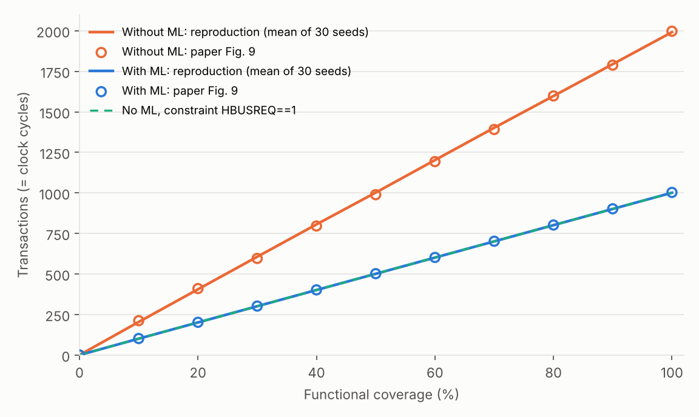

# AFCML reproduction

An open-source reproduction of the results reported in

> S. J. Shah, M. Ahmed, M. Imran, H. Waris, N. Mohyuddin, and M. U. Rehman,
> "AFCML: Accelerating the Functional Coverage through Machine Learning within a UVM Framework,"
> National University of Sciences & Technology (NUST), Pakistan.

This repository accompanies the Phase 1 report of our CMP490 senior design project at the
American University of Sharjah (Fall 2026). It is the baseline for the project's later work.

The paper does not publish its code, coverage model or stimulus generator. Everything here
about how AFCML works internally is **our reconstruction** from the paper's text, figures and
result tables. It is not a statement about the authors' actual setup.



## Results

Transactions needed to reach each coverage level. The reproduction is the mean of 30 seeds.

| | 10 % | 50 % | 100 % | RMSE over all ten 10 % checkpoints |
|---|---|---|---|---|
| Paper, without ML (Fig. 9) | 212 | 989 | 1997 | |
| Reproduction, without ML | 204 | 1002 | **1991 ± 40** | 8.5 |
| Paper, with ML (Fig. 9) | 102 | 502 | 1003 | |
| Reproduction, with ML | 101 | 501 | **1001** | 1.1 |
| Reproduction, no ML, constraint `HBUSREQ == 1` | 101 | 501 | **1001** | 1.1 |

- **Simulation time** equals transactions × 10 ns, so it also drops by 49.7 %, as the paper reports.
- **The constraint-only baseline matches the ML result.** In our reconstruction, a single random
  constraint (`HBUSREQ == 1`) with no ML at all needs the same 1001 transactions. Any method that
  claims an improvement should be compared against both baselines: plain constrained-random
  testing (~1991) and this constrained baseline (1001).
- **Decision-tree accuracy is not informative here.** The tree reaches 96 % held-out accuracy, but
  always predicting "no coverage" also scores 96 %, because only 12 % of rows are positive
  (`results/dt_reports.json`).

All numbers: `results/fit_vs_paper.json`.

## How the setup was reconstructed

| Evidence in the paper | What we inferred |
|---|---|
| Fig. 9: time = 10 × transactions − 4 ns at almost every checkpoint | one transaction is one 10 ns clock cycle |
| Fig. 9: coverage rises linearly with transactions | coverage behaves as a hit counter toward a fixed goal |
| Fig. 9: with ML, exactly +100 transactions per +10 % | every selected stimulus scores, so the goal is 1000 hits |
| Fig. 9: without ML, about +200 transactions per +10 % | a random stimulus scores about half the time |
| Figs. 4–5: CSV columns `M_HBUSREQ … M_HWDATA`, with HTRANS, HSIZE, HBURST, HPROT and HLOCK always 0 | a stimulus is one master's interface values for one cycle; only HBUSREQ, HADDR, HWRITE and HWDATA vary |
| Test plan: "masters acquiring their grants for certain times" | the coverage counter counts cycles in which the master holds its grant |
| Fig. 4 "Coverage" column, replayed on the RTL | the training label is "granted ∧ HBUSREQ ∧ HWRITE" (matches 16/16 rows, but only 2 rows are positive, so this is weak evidence) |
| DUT "generated from" gen_amba_2021, no configuration given | the generator's default AHB: 2 masters, 2 slaves; the testbench drives master 0 |

The ML pipeline follows the paper's description: test classification, K-means++ clustering
(k = 4), one decision tree per cluster, and a scheduler that switches cluster files after two
consecutive stimuli that don't change coverage. Predicted-redundant stimuli run last.

### What remains unknown

- The paper's coverage model, stimulus constraints and code.
- A residual gap of 2 transactions at 100 % (1001 vs. 1003) and a −4 ns time offset, most
  likely reset and sampling details of the original testbench.
- Address and data ranges, read off Figs. 4–5 (0–399 and 0–4999). They do not affect results.

## Differences from the paper's tool flow

- **Language and simulator:** a Python UVM testbench (pyuvm + cocotb) on Icarus Verilog 12,
  instead of SystemVerilog UVM on Mentor QuestaSim 10.6. The component structure follows the
  paper's Fig. 2 (master agent, slave agent, monitor, scoreboard, functional coverage).
- **Repetition:** 30 seeds per configuration instead of a single run.

## Running it

Requirements: Python 3.11+ and Icarus Verilog 12.

```bash
pip install -r requirements.txt
./reproduce.sh
```

This takes about 3–5 minutes on 2 cores. It regenerates `results/`, `figures/` and a
training set in the paper's Fig. 4 CSV format (`data/train_paper_format.csv`).

## Repository layout

```
rtl/amba_ahb_m2s2.v        DUT: AHB bus generated by gen_amba_2021 with default settings
tb/stimulus.py             stimulus rows in the paper's Fig. 4 format, CSV export
tb/tb_ahb.py               pyuvm test: agents, monitor, scoreboard, coverage (rules A and B), scheduler
run_sim.py                 builds the DUT and runs one simulation
ml.py                      stage 1 test classes, stage 2 K-means++, stage 3 decision trees
scripts/prepare_training.py    training simulation (20,000 rows)
scripts/check_fig4.py          replays the 16 rows of Fig. 4 and compares the labels
scripts/experiments.py         all configurations, 30 seeds each
scripts/analyze.py             comparison with Fig. 9  -> results/fit_vs_paper.json
scripts/plot.py                figure                  -> figures/fit_vs_paper_fig9.png
```

Configurations run by `scripts/experiments.py`:

| Name | Meaning |
|---|---|
| `base_A` | plain constrained-random stimulus, coverage = grant cycles |
| `smart_A` | no ML, constraint `HBUSREQ == 1` |
| `ml_A_B` | AFCML pipeline, trained on the Fig. 4 label (the configuration shown above) |
| `ml_A_A_next`, `ml_A_A_same` | the pipeline trained on alternative labels (`A_same` is at chance level and still reaches 1005) |
| `base_B`, `smart_B`, `ml_B_B` | the same, with coverage counted by the Fig. 4 rule instead |

## Checks

- The scoreboard checks the arbiter contract (with master 1 idle, master 0 is granted if and
  only if it requested in the previous cycle), that only one master is ever granted, and that
  no bus transfer occurs. There are no violations in any run.
- Every run is deterministic: rerunning a seed reproduces the identical per-cycle log.

## Third-party code

`rtl/amba_ahb_m2s2.v` was generated with
[gen_amba_2021](https://github.com/adki/gen_amba_2021) by Ando Ki and keeps its original
copyright notice and BSD-style license text at the end of the file.
